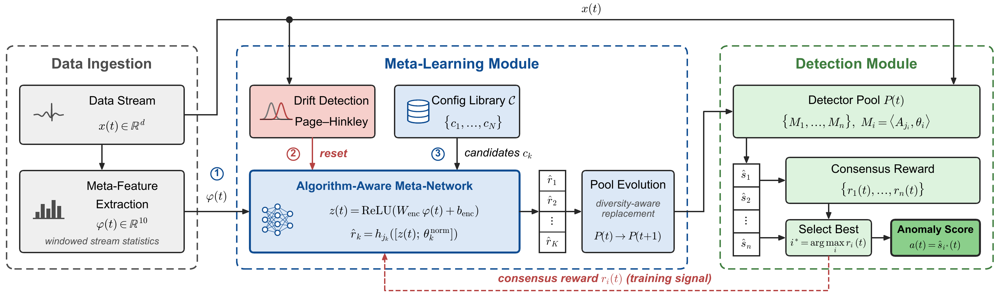

# NOMAD: Neural Online Meta-learning for Automated Anomaly Detection

Official implementation of **NOMAD** (KDD 2027).

NOMAD picks a streaming anomaly detector and its hyperparameters on the fly, without labels. It keeps a
pool of diverse detectors and scores them with an unsupervised consensus reward. That reward trains an
**Algorithm-Aware Meta-Network (AAMN)**: a shared encoder summarises the current stream state, and
algorithm-specific heads map hyperparameters to expected rewards, so NOMAD can rank configurations it has
never run. Diversity-aware pool evolution keeps the pool robust, and Page-Hinkley drift detection resets
the meta-learner when the stream changes.



## Repository layout

```
.
├── src/
│   ├── NOMAD/            # NOMAD (AAMN meta-learner, consensus reward, pool evolution, drift detectors)
│   ├── AutoSAD/          # AutoSAD baseline
│   ├── SEAD/             # SEAD baseline
│   ├── DyMETER/          # DyMETER baseline (our re-implementation)
│   ├── ARCUS/, METER/    # neural baselines: upstream code is fetched by tools/fetch_neural_baselines.sh
│   ├── pysad/            # vendored PySAD (streaming utilities and metrics)
│   └── pysad_rust/       # Rust implementations of the base detectors (HST, iForestASD, RRCF, LODA, OIF, SIF, xStream, RS-Hash)
├── benchmarks/
│   ├── scripts/          # one runner per method: nomad_run.py, hst_run.py, ...
│   ├── run_scripts.py    # main benchmark: all methods x all datasets x 10 runs
│   ├── ablation_study_nomad.py
│   ├── sensitivity_analysis_nomad.py
│   ├── drift_detector_ablation.py
│   ├── run_insects_drift.py
│   ├── consensus_collapse_stress.py
│   ├── detection_delay_analysis.py
│   └── run_all_experiments.py
├── datasets/             # the 16 benchmark streams (.npz)
├── tools/                # helper scripts
└── results/              # experiment outputs are written here
```

## Installation

You need Python 3.10+ and a Rust toolchain (for the base detectors). Install Rust with
[rustup](https://rustup.rs) if `cargo --version` fails.

```bash
git clone https://github.com/TechyNilesh/NOMAD.git
cd NOMAD

python -m venv .venv
source .venv/bin/activate            # Windows: .venv\Scripts\activate

pip install -r requirements.txt
pip install ./src/pysad_rust         # builds the Rust detectors with maturin
```

Check the install:

```bash
python -c "import pysad_rust; print('ok')"
```

## Quick start

Every runner is run from `benchmarks/scripts`. Dataset names are the file names in `datasets/` without
`.npz`.

```bash
cd benchmarks/scripts

# Short test on the first 2,000 instances of Bank
python nomad_run.py --dataset 50_bank --max_samples 2000

# Full stream
python nomad_run.py --dataset 50_bank --seed 42
```

Each run writes one JSON file to `benchmark_results/` (change it with `--output_dir`), named
`<Method>_<dataset>[_<run>].json`. It holds the stream AUC, Precision@k, total runtime, peak memory, and
the same metrics for every window of 1,000 instances.

### NOMAD options

The defaults are the configuration used in the paper, fixed across all datasets.

| Option | Default | Meaning |
|---|---|---|
| `--n_pool_models` | 10 | detectors kept in the pool |
| `--n_candidate_configs` | 100 | size of the configuration library |
| `--evolution_interval` | 1000 | instances between pool-evolution steps |
| `--K` | 20 | candidates sampled per evolution step |
| `--diversity_weight` | 0.3 | diversity penalty during selection |
| `--meta_lr` | 0.01 | meta-network learning rate |
| `--shared_dim` / `--head_hidden_dim` | 32 / 16 | AAMN encoder and head sizes |
| `--feature_window_size` | 100 | window for the stream meta-features |
| `--drift_delta` / `--drift_threshold` | 0.005 / 50 | Page-Hinkley drift detector |

Run `python nomad_run.py --help` for the full list.

### Use NOMAD in your own code

```python
import sys
sys.path.insert(0, "src")            # path to this repository's src/ folder

import numpy as np
from NOMAD.nomad import NOMAD

X = np.ascontiguousarray(np.load("datasets/50_bank.npz")["X"], dtype=np.float64)

# Paper defaults. Half-Space Trees in the pool need per-feature bounds.
model = NOMAD(feature_mins=X.min(axis=0), feature_maxes=X.max(axis=0))

scores = [model.fit_score_partial(x) for x in X]   # one instance at a time; higher = more anomalous
```

## Baselines

Each baseline has its own runner in `benchmarks/scripts` with the same `--dataset`, `--seed` and
`--output_dir` options.

| Method | Runner |
|---|---|
| NOMAD-P (perceptron meta-learner) | `nomad_perceptron_run.py` |
| Random ensemble | `random_search_ensemble_run.py` |
| AutoSAD | `autosad_run.py` |
| SEAD | `sead_run.py` |
| Half-Space Trees | `hst_run.py` |
| iForestASD | `ifasd_run.py` |
| Online Isolation Forest | `oif_run.py` |
| Streaming Isolation Forest | `sif_run.py` |
| Robust Random Cut Forest | `rrcf_run.py` |
| LODA | `loda_run.py` |
| RS-Hash | `rshash_run.py` |
| xStream | `xstream_run.py` |
| ARCUS, METER, DyMETER | `arcus_run.py`, `meter_run.py`, `dymeter_run.py` |

ARCUS, METER and DyMETER need extra packages and the upstream ARCUS/METER code:

```bash
pip install hypnettorch==0.0.4 "tensorflow>=2.16" "tf-keras>=2.16"
bash tools/fetch_neural_baselines.sh
export TF_USE_LEGACY_KERAS=1          # needed for ARCUS
```

See `src/ARCUS/README.md`, `src/METER/README.md` and `src/DyMETER/README.md` for the protocol and the
fixes each one needed.

## Reproducing the experiments

```bash
cd benchmarks

# Main benchmark: every method on all 16 datasets, 10 runs each
python run_scripts.py --mode all

# One method on all datasets, or all methods on one dataset
python run_scripts.py --mode model --name nomad
python run_scripts.py --mode dataset --name 10_cover

# NOMAD component ablation and hyperparameter sensitivity
python ablation_study_nomad.py
python sensitivity_analysis_nomad.py --param meta_lr

# Drift detector comparison (Page-Hinkley, ADWIN, KSWIN, DDM, none)
python drift_detector_ablation.py

# Controlled concept drift on INSECTS (see datasets/README.md for the data)
python run_insects_drift.py

# Everything, in order (add --dry-run to only print the commands)
python run_all_experiments.py --suite all
```

The full benchmark is long (16 datasets x 10 runs x 16 methods). Use `--mode model` or `--mode dataset`
to run parts of it, and `--max_samples` on a single runner for quick checks.

## Datasets

`datasets/` contains the 16 streams used in the paper, from ADBench and ADRepository. Each runner shuffles
the stream with `--seed`, then processes it one instance at a time with prequential (test-then-train)
evaluation. See
`datasets/README.md` for sources and for the INSECTS drift streams.

## Citation

If you use NOMAD, please cite:

```bibtex
@inproceedings{verma2027nomad,
  title     = {Neural Online Meta-learning for Automated Anomaly Detection},
  author    = {Verma, Nilesh and Bifet, Albert and Pfahringer, Bernhard and Bahri, Maroua},
  booktitle = {Proceedings of the 33rd ACM SIGKDD Conference on Knowledge Discovery and Data Mining V.1 (KDD '27)},
  year      = {2027},
  address   = {San Jose, CA, USA},
  publisher = {ACM},
  doi       = {10.1145/3862868.3871215}
}
```

## License

NOMAD is released under the [MIT License](LICENSE). `src/pysad` is a modified copy of
[PySAD](https://github.com/selimfirat/pysad) under the BSD 3-Clause License (see `src/pysad/LICENSE`).
ARCUS and METER are not redistributed; `tools/fetch_neural_baselines.sh` downloads them from their
authors' repositories.
